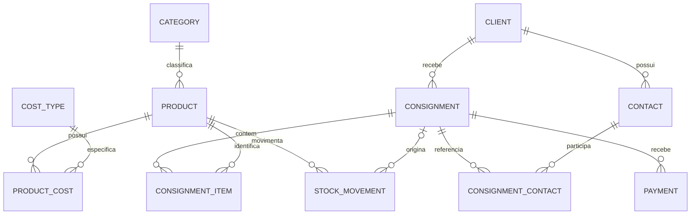

# Estrutura do banco — Melo Joias

SQLite local, sem serviço de banco ou conexão com a nuvem. O Django cria e atualiza a estrutura por migrações. Os nomes abaixo correspondem às 11 tabelas de negócio.

| Tabela | Finalidade e campos principais |
|---|---|
| `core_category` | Categoria: nome único, descrição, ativa. |
| `core_product` | Produto: SKU único, EAN-13 interno único, nome, categoria, descrição, preço de venda, estoque disponível, estoque mínimo, ativo. |
| `core_costtype` | Tipo de custo: nome único, descrição, ativo. |
| `core_productcost` | Custo unitário do produto: produto, tipo de custo, descrição, valor. |
| `core_client` | Cliente: nome, CPF/CNPJ, telefone, e-mail, endereço, observações, ativa. |
| `core_contact` | Contato da cliente: cliente, nome, vínculo/referência, telefone, e-mail, observações. |
| `core_consignment` | Consignação: cliente, data de envio, data de acerto, situação, observações. |
| `core_consignmentcontact` | Referências da consignação: consignação e contato, sem duplicatas. |
| `core_consignmentitem` | Peça consignada: produto, consignação, quantidades enviadas/vendidas/devolvidas, preço, nome/SKU/custo preservados no envio. |
| `core_payment` | Pagamento vinculado à consignação: valor, data, forma e observações. |
| `core_stockmovement` | Histórico de movimentações: produto, consignação quando aplicável, tipo, quantidade assinada, observação e data/hora. |



## Integridade

- Chaves primárias numéricas e chaves estrangeiras explícitas relacionam os registros.
- Preços e custos usam campos decimais com duas casas. A aplicação calcula os totais com `Decimal`, sem converter valores monetários para `float` nem somá-los em ponto flutuante no SQLite.
- SKU, EAN-13 interno, nomes de categorias e nomes dos tipos de custo têm unicidade.
- A migração `0002_product_ean13` preenche o EAN nos produtos existentes antes de aplicar obrigatoriedade e unicidade. O EAN é gerado na criação de novos produtos e preservado em edições; não substitui o SKU histórico. É um código interno de circulação restrita, não um GTIN comercial registrado.
- Restrições impedem estoque/preços negativos, itens com quantidade zero, quantidades vendidas mais devolvidas maiores que as enviadas e acerto anterior ao envio.
- A combinação de consignação/produto é única por item, assim como consignação/contato nas referências.
- Contatos de referência são validados para pertencer à mesma cliente da consignação.
- Envio, devolução, pagamento, ajuste e encerramento passam por operações transacionais. No SQLite, `IMMEDIATE` reserva a escrita antes de ler o saldo, e o tempo de espera é de 20 segundos. Duas saídas simultâneas não podem consumir o mesmo estoque.
- Produtos e clientes usados em históricos têm exclusão protegida. A interface oferece inativação de cadastros onde aplicável.
- Preço, custo, nome e código dos itens enviados ficam preservados para consultas futuras.

## Estoque e acerto

O estoque do produto é a quantidade disponível fisicamente para novos envios. Um rascunho não reserva peças. Ao enviar, toda a remessa é validada e a quantidade é descontada; a operação inteira é revertida se faltar qualquer item. A venda informa o que já saiu em consignação e não desconta o estoque novamente. Uma devolução aumenta o estoque disponível.

Cada acerto registra quantidades adicionais vendidas ou devolvidas. O sistema rejeita valores negativos, fracionados ou acima das peças pendentes. O histórico de estoque registra entradas e devoluções positivas, envios negativos e ajustes com sinal; a interface não altera registros antigos.

Pagamentos são limitados ao saldo das vendas já informadas. Uma consignação só pode ser encerrada quando todas as peças foram vendidas ou devolvidas e o saldo financeiro é zero. Apenas rascunhos podem ser cancelados; para finalizar uma remessa enviada sem vendas, devolva todas as peças e encerre.

| Total calculado | Regra |
|---|---|
| Valor da remessa | Soma de quantidade enviada × preço unitário preservado. |
| Valor vendido | Soma de quantidade vendida × preço unitário preservado. |
| Valor recebido | Soma dos pagamentos registrados. |
| Saldo a receber | Valor vendido − valor recebido. |
| Peças pendentes | Enviadas − vendidas − devolvidas. |
| Custo unitário atual | Soma dos componentes de custo cadastrados para o produto. |

Os valores calculados não são gravados como colunas duplicadas. A identificação visível `MJ-0001` deriva da chave numérica da consignação. O alerta de atraso considera somente remessas em andamento com prazo anterior à data local em `America/Sao_Paulo`.

## Arquivos e demonstração

O banco de trabalho padrão fica em `data/melo.sqlite3`. A demonstração usa outro arquivo, `data/demo.sqlite3`, quando `MELO_DEMO_MODE=1`. O comando explícito `seed_demo` cria dados fictícios somente em um banco sem cadastros; ele nunca é executado ao simplesmente abrir a aplicação. O instalador de demonstração seleciona o arquivo separado.

O backup usa a API de backup do SQLite, que produz uma cópia consistente também com a aplicação aberta. Guarde cópias em outro dispositivo se precisar proteger os dados contra falha do computador. Consulte o README para abrir a aplicação, fazer backup e restaurar.

Tabelas adicionais `django_*` e `auth_*` são geridas pelo Django. A presença das tabelas de autenticação não implica uma tela de login no protótipo.

As definições exatas e índices estão em `core/models.py` e `core/migrations`. `docs/schema.sql` contém o SQL gerado para a migração inicial SQLite, para consulta. A instalação deve usar `manage.py migrate`, pois o Django também administra suas tabelas internas e o controle de versões das migrações. Para inspecionar o SQL sem executá-lo:

```powershell
.venv\Scripts\python.exe manage.py sqlmigrate core 0001
```
